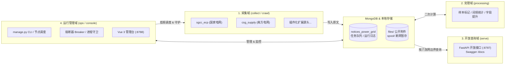

# 🕸️ 招投标大师 (Tender Master) · 公开招投标公告解析与「六张网」数据底座

> **技术栈**：`Python 3.10+` · `FastAPI` · `Vue 3 + Element Plus` · `MongoDB` · `Selenium / Undetected-Chromedriver` · `DDD 领域驱动设计`
> **定位**：纯粹的个人非营利性技术学习与学术探索归档项目（涵盖 20+ 国内公开政务、央国企能源电力、交通运输及行业平台公开公告的 DOM 解析与正则结构化提取示例）

**快速导航**：[项目前景与现实意义](#-项目前景与现实意义为什么做这件事) ｜ [项目初衷与开源寄语](#-项目初衷与开源寄语) ｜ [作者的一点思考](#-作者的一点思考关于数据注意力与无界-wj_的谦卑) ｜ [法律合规与免责声明（必读）](#️-法律合规与免责声明必读) ｜ [全量脚本名录](#️-全量爬虫脚本名录) ｜ [核心技术与提取规范](#-核心技术与提取规范) ｜ [系统架构演进](#-系统架构演进ddd-四边界模型) ｜ [快速开始](#-快速开始) ｜ [致谢与联系方式](#-致谢与联系方式)

---

## 🌏 项目前景与现实意义：为什么做这件事？

在很多外界人眼里，招投标信息似乎只是枯燥的公文；但在真实的商业世界里，**它是无数中小型企业赖以生存和发展的“订单生命线”**。

之所以在当时投入大量精力去摸索这一整套深网采集与数据底座，是因为我看到了这个方向背后**极其庞大的市场前景与真实的社会价值**：

1. **解决广大中小企业老板最迫切的“找活干、找商机”痛点**：
   * 国内每天有成千上万条政务、央国企、能源、交通、通信、金融及行业采购需求分散在数百个各自独立的招投标平台上。
   * 大企业有专门的投标团队和昂贵的信息渠道，而**绝大多数中小型企业的老板和业务团队，根本没有精力每天去几十个网站逐个翻找、甄别**。往往等他们看到消息时，报名早就截止了，或者被信息差挡在了门外。
2. **打破信息壁垒，把“大海捞针”变成“精准交付”**：
   * 如果这套底座加上上层的业务筛选能够运作得好——不再是把成千上万条未经清洗的原始公告一股脑砸给用户，而是真正帮中小企业老板把预算、截止时间、采购人、核心标段和匹配度提炼出来，**在正确的时间把真正能做、够得着的商机推到他们面前**——它就能实实在在地帮中小企业省下高昂的信息检索成本，甚至直接帮一家小企业拿到救命的订单。
3. **AI 正在彻底冲破传统招投标与数据采集公司的“伪壁垒”**：
   * 坦白讲，我认为现在市面上很多传统招投标信息公司或者专门做数据采集的公司，**他们过去赖以生存的所谓“数据壁垒”，最终一定会被 AI 彻底冲破**。
   * 过去这门生意能靠收高昂的会员费维持，本质上并不是因为技术门槛有多高，恰恰相反，它只是靠堆人力去维护几百个站点的解析脚本、靠信息不对称筑起了一道“苦力墙”。而在今天 AI 与大模型 Agent 极其强大的背景下，写爬虫、做页面解析的门槛已经被踏平——**任何一个懂业务的独立开发者或轻量级平台，都能迅速拉起一套采集底座**。
   * 当“把数据抓下来”不再是壁垒时，未来真正的胜负手，一定会从“谁爬的数据多”转向**“谁更懂中小企业老板的痛点、谁能用 AI 把信息提炼得真正有用”**。这也正是我决定把这套底层采集底座直接开源出来的原因——旧的采集壁垒已经瓦解，真正的价值创造才刚刚开始。

---

## 💬 项目初衷与开源寄语

各位老板、同行、开发者朋友，大家好！

这个项目最早是我在探索**垂直行业公开网页（Deep Web）DOM 解析、非结构化文本正则提取与数据底座架构**时，一点一滴写出来的学习代码合集。

在当时，**AI 辅助编程与大模型（LLM）技术还没有今天这么强盛**，面对各种复杂的动态网页渲染、`iframe` 多层嵌套、五花八门的文本格式以及多进程浏览器的内存回收，全靠人工观察网页结构、抠 HTML 样本（项目里 [`喂给模型的内容/`](./喂给模型的内容) 目录下还保留着当时整理的部分静态页面结构样本与正则提取规范）和反复试错熬出来。

后来由于个人精力转移，我已不再继续开发和维护这个项目。与其让这些代码在硬盘里落灰，不如将它们整理脱敏后**完全免费地公布出来**，供对浏览器自动化、正则表达式清洗或 DDD 数据架构感兴趣的朋友作技术学习与参考。

> [!NOTE]
> **完全非营利声明 & 致后来的开发者**
> 1. **零商业与零盈利性质**：本项目从最初的编写到如今的公开，**纯粹出于个人技术学习与工程探索目的**。过去没有、现在没有、**未来也绝不会有任何收费、售卖数据、商业代爬或任何盈利性行为**。
> 2. **欢迎借力现代 AI 自由改进**：受限于早期编写时的技术条件与个人精力，部分脚本在优雅度或边缘字段提取上不可避免存在不足，还请各位老板和看官多多包涵、见谅！如今 AI 技术已经无比强大，非常欢迎大家在此基础上用现代大模型重构解析逻辑、修复问题或提交任何修改建议。

---

## 💡 作者的一点思考：关于数据、注意力与「无界 (`wj_`)」的谦卑

在把这一整套深网采集脚本与数据底座整理开源之际，我也想在这里留下几段自己在探索过程中的真实思考：

### 1. 信息与注意力：换位思考才是长期做事的本质
> **信息最终是给人去观看的。但人的注意力终究极其有限，每个人每天只能消化有限的信息，而不同个体愿意承载和阅读的信息维度又无比复杂。**
>
> 所以在折腾过这么多底层采集、正则清洗和系统架构之后，我越来越深刻地体会到：**所谓的工程技术，其实只是一方面；真正决定一份信息“要不要被看见、值不值得被消费”的，是你对用户的感知、对用户的理解，以及你如何去看待“用户看待你东西的方式”。**
>
> **唯有真正置身事内、学会换位思考，才是能够长期做好一件事情的本质。** 因为人际与商业交互的本质，终究是价值的交换；而价值本身，不正是源于你真正洞察并解决了对方的痛点吗？

### 2. 数据与业务：先换位思考“什么不该采”，没人愿意看一堆数据垃圾
> **数据本身只是被分析的客体（原材料）。至于具体要剖析哪些维度、挖掘到什么颗粒度、分析到什么水平，从来不是由技术决定的，而是取决于你要去做什么业务、你所面向的客户真正需要什么。**
>
> 更关键的是：**只有当你真正站在用户的角度去换位思考之后，你才明白到底哪些数据该采、哪些数据根本不需要采。**
>
> 很多做技术的人容易陷入一种误区，以为“抓得越全越牛、塞得越多越好”。但试问：**采一大堆毫无价值的垃圾数据丢给人家看，这真的是好的吗？用户每天忙得焦头烂额，他们要看的是这些垃圾吗？**
>
> 如果连“用户真正想看什么、什么对用户才是有效信息”这一点都没有想通，那写再多的爬虫、做再庞大的系统又有什么意义呢？所以很多时候，先想清楚业务场景、先帮用户把噪音和垃圾挡在门外，比一上来就扎进技术细节里盲目堆砌数据要重要得多。

### 3. 为什么旧爬虫都以 `wj_` 开头？——「无界」与技术平权下的谦卑
> 细心的朋友可能会发现，我在 [`wj_spiders/`](./wj_spiders) 目录下编写的那 15 个标准化站点爬虫，文件名全部以 **`wj_`** 开头。
>
> **`wj` 其实就是「无界」的意思。**
>
> 我始终认为，**技术最终是走向平权的，不应该有高高在上的边界与壁垒**。没有任何人可以傲慢地认为自己的技术能永远保持领先，或者永远垄断某一个领域。面对时代与技术，**人最重要的一种底色应当是「谦卑」**——你今天引以为傲的专业知识、花无数个日夜攒出来的独门手艺，极有可能在某一天被飞速演进的 AI 彻底超越。
>
> 也正因如此，我平时非常反感有些技术人员喜欢堆砌别人听不懂的晦涩术语，或者为了炫技搞出一大堆故作高深的复杂逻辑，到头来却恰恰忘记了最根本的一件事：**你的用户到底是谁？他们真正需要解决的问题是什么？**

这段招投标数据底座的探索在这里画上了一个句号，但我对产品、技术与用户价值的思考还在继续。**我坚信在未来的日子里，我还会怀着这份对用户的敬畏与谦卑，持续打磨、做出更多更好的作品。**

🌟 **如果你有幸在茫茫代码海中刷到了这个项目，或者这里的某一行代码、某一段思考曾给你带来一点点共鸣与帮助，欢迎给本仓库点亮一颗 `Star ⭐`，也欢迎 `Follow` 关注我的 GitHub 主页（[@Lappercn](https://github.com/Lappercn)），我们下一程作品见！**

---

## ⚖️ 法律合规与免责声明（必读）

> [!CAUTION]
> **在使用、复制、修改或分发本仓库任何代码与文档前，请务必完整阅读以下法律与合规条款。一旦您下载、克隆或运行本项目，即视为您已充分知悉并同意无条件遵守以下全部约定：**

### 1. 性质界定与非营利原则（技术中立与研究属性）
* 本仓库仅展示**通用的浏览器自动化测试、网页 DOM 解析算法与正则表达式文本清洗技术**，属于纯技术方法研究与代码归档。
* **本仓库不包含、不存储、不提供任何真实的商业业务数据库、公民个人隐私数据或涉密数据**。
* 作者发布本项目**不收取任何费用，亦不接受任何商业委托**。严禁任何个人或组织将本项目直接打包用于商业售卖、付费代爬或非法数据交易。

### 2. 数据源属性与《Robots 协议》遵守义务
* 本项目中出现的所有目标网址，其解析目标均严格限定于各平台依法向社会公众公开展示的**公开招投标公告栏目**（依据《中华人民共和国招标投标法》《中华人民共和国政府采购法》向社会公开发布的阳光政务/阳光采购信息）。
* 使用者在运行任何测试脚本前，**必须自行核查并严格遵守目标网站的 `robots.txt`（爬虫协议）及网站《用户服务协议》**。若目标网站更新了服务条款或明确禁止自动化程序访问，使用者应立即停止对该站点的测试。

### 3. 严禁干扰目标系统正常运行（刑法第 286 条合规红线）
* 为保护目标网站服务器，本项目在设计时严格内置了随机休眠等待（`1.5s ~ 3.0s`）、低频间隔调度及节点熔断保护器（`Breaker`）。
* **严禁任何人删改限流休眠代码，严禁使用高并发、多线程或分布式集群对任何目标网站发起高频请求或压力测试**。绝不允许干扰目标网站的正常办公与对外服务，更严禁造成目标服务器负载过高或瘫痪（违反《中华人民共和国刑法》第二百八十六条【破坏计算机信息系统罪】）。

### 4. 严禁突破技术防护与敏感平台红线（刑法第 285 条合规红线）
* **不提供任何商业平台账号或破解凭证**：部分历史研究脚本（如金采网、千里马等）涉及登录后页面的结构解析，本项目已**彻底剥离所有账号凭证与第三方密钥**。使用者仅可在拥有自己合法注册且获授权的账号前提下，在合理频次内做个人学习测试。
* **严禁技术越权与恶意逆向**：严禁利用本项目代码对任何政务、央国企、公共资源交易或特殊行业平台（如 `plap_spider.py` 等仅作静态 DOM 学习示例的脚本）进行非公开接口探测、漏洞扫描、绕过安全防护机制或未经授权的数据抓取（违反《中华人民共和国刑法》第二百八十五条【非法获取计算机信息系统数据罪】）。**强烈建议仅针对本地静态 HTML 样本进行离线解析学习，不在生产环境运行针对敏感站点的抓取。**

### 5. 公民个人信息保护红线（《个人信息保护法》合规）
* 公开招投标公告正文中通常附有项目联系人的姓名与办公电话。本项目中的联系人正则提取逻辑（`contacts`）仅用于演示非结构化文本的邻近窗口提取算法。
* **严禁任何使用者将从公开公告中提取的联系人姓名、电话号码用于电话推销骚扰、垃圾短信发送、非法汇总倒卖或任何侵害公民个人信息的违法活动**（违反《中华人民共和国个人信息保护法》及《刑法》第二百五十三条之一【侵犯公民个人信息罪】）。

### 6. 责任豁免与权利人移除通道（Notice & Takedown）
* 本项目按“原样（AS-IS）”开源分享，作者不对代码的完整性、时效性或适用性作任何明示或暗示的担保。
* **因使用者违反上述条款、违背国家法律法规（包括但不限于《网络安全法》《数据安全法》《个人信息保护法》《反不正当竞争法》《刑法》）或滥用代码所引发的一切服务器封禁、民事侵权赔偿、行政处罚或刑事责任，均由使用者本人独立承担全部法律责任，与本项目作者及交流伙伴无关！**
* **权利人通知通道**：如果任何相关平台方、机构或权利人认为本仓库中的某段解析示例、类名或文档存在不妥或潜在风险，请随时发送邮件至 **`shibaizhelianmeng@gmail.com`** 与作者联系，作者将在收到通知后的第一时间无条件配合删除相关代码或下架处理。

---

## 🕷️ 全量爬虫脚本名录

本项目包含**三个演进阶段**的公开公告解析代码，涵盖全国国家级汇总平台、地方政府采购、能源电力、石油化工、交通运输、通信邮政、民航及烟草金融等 20+ 数据源（背景整理详见 [`所有待爬取的网站.md`](./所有待爬取的网站.md)）。

### 一、 新版「六张网」领域驱动（DDD）插件化模块（`collect/` & `crawl/`）

面向「六张网」基础设施设计的模块化架构，支持主从队列分发、断网本地暂存回放（Spool & Replay）、节点熔断与独立浏览器沙箱回收：

| 源头 ID | 所属业务网 | 平台名称 | 官方网址 | 代码位置 | 特色能力说明 |
| :--- | :--- | :--- | :--- | :--- | :--- |
| **`sgcc_ecp`** | 新型电网 | **国家电网新一代电子商务平台** | `ecp.sgcc.com.cn` | [`collect/sources/sgcc_ecp/`](./collect/sources/sgcc_ecp) / [`crawl/spiders/sgcc.py`](./crawl/spiders/sgcc.py) | 覆盖招标/采购/候选人/结果栏目，支持通过 URL 参数 `noticeId` + `noticeDetId` 构造公开附件下载 |
| **`csg_supply`** | 新型电网 | **中国南方电网供应链统一服务平台** | `www.bidding.csg.cn` | [`collect/sources/csg_supply/`](./collect/sources/csg_supply) / [`crawl/spiders/csg.py`](./crawl/spiders/csg.py) | 支持多栏目分页解析、正文清洗、预算金额与多联系人组合提取、公开附件落盘 |

---

### 二、 15 个「无界 (`wj_*`)」标准化公开站点解析脚本（[`wj_spiders/`](./wj_spiders)）

该系列脚本统一归档在 [`wj_spiders/`](./wj_spiders) 文件夹下，遵循《[无界-数据清单-爬虫规范（落地版）](./喂给模型的内容/无界-数据清单-爬虫规范（落地版）.md)》，统一读取 [`config.py`](./config.py) 配置，采用**标题清洗 MD5 指纹去重**、统一数据字典格式与标准化正则提取：

| 行业领域 | 脚本文件路径 | 目标平台名称 | 目标网址 | 技术特点与解析范围 |
| :--- | :--- | :--- | :--- | :--- |
| **综合政务** | [`wj_spiders/wj_ccgp_china.py`](./wj_spiders/wj_ccgp_china.py) | **中国政府采购网** | `www.ccgp.gov.cn` | 公开招标、询价、竞争性谈判、中标公告等多栏目 DOM 解析 |
| **综合政务** | [`wj_spiders/wj_ccgp_chongqing.py`](./wj_spiders/wj_ccgp_chongqing.py) | **重庆市政府采购网** | `www.ccgp-chongqing.gov.cn` | 地方政采结构化解析示例，支持相对时间/绝对日期过滤、6 级预算与联系人配对提取 |
| **综合政务** | [`wj_spiders/wj_ggzy_china.py`](./wj_spiders/wj_ggzy_china.py) | **全国公共资源交易平台** | `www.ggzy.gov.cn` | 跨行业公共资源交易公开信息列表与详情提取 |
| **能源电力** | [`wj_spiders/wj_sgcc_china.py`](./wj_spiders/wj_sgcc_china.py) | **国家电网电子商务平台 (独立版)** | `ecp.sgcc.com.cn` | 独立运行版国网公开公告解析脚本，含附件链接动态构造示例 |
| **能源电力** | [`wj_spiders/wj_csg_china.py`](./wj_spiders/wj_csg_china.py) | **南方电网供应链平台 (独立版)** | `www.bidding.csg.cn` | 独立运行版南网公开公告解析脚本，覆盖招标、变更及结果公示 |
| **能源电力** | [`wj_spiders/wj_chnenergy_china.py`](./wj_spiders/wj_chnenergy_china.py) | **国家能源招标网** | `www.chnenergybidding.com.cn` | 覆盖招标、资格预审、非招标、中标、变更、候选人公示、终止公告 7 大公开栏目 |
| **能源电力** | [`wj_spiders/wj_huaneng_china.py`](./wj_spiders/wj_huaneng_china.py) | **中国华能集团电子商务平台** | `ec.chng.com.cn` | SPA 动态渲染页面等待、多栏目切换与详情提取 |
| **石油化工** | [`wj_spiders/wj_cnpc_china.py`](./wj_spiders/wj_cnpc_china.py) | **中国石油电子招标投标交易平台** | `www.cnpcbidding.com` | 结合 `ddddocr` 开源 OCR 库学习基础验证码识别与公开公告解析 |
| **石油化工** | [`wj_spiders/wj_sinochem_china.py`](./wj_spiders/wj_sinochem_china.py) | **中化商务电子招投标平台** | `e.sinochemitc.com` | 公开采购公告、控制价与标段文本提取 |
| **交通运输** | [`wj_spiders/wj_guotie_china.py`](./wj_spiders/wj_guotie_china.py) | **国铁采购平台 (原 95306)** | `cg.95306.cn` | 公开物资与工程采购公告解析 |
| **交通运输** | [`wj_spiders/wj_chinapost_china.py`](./wj_spiders/wj_chinapost_china.py) | **中国邮政电子采购与供应平台** | `cg.11185.cn` | 邮政公开采购信息列表分页与详情解析 |
| **民航交通** | [`wj_spiders/wj_airchina_china.py`](./wj_spiders/wj_airchina_china.py) | **中国国航 (中航集团采购平台)** | `pur.airchina.com.cn` | 公开采购公告、截止时间与联系人组合提取 |
| **通信 IT** | [`wj_spiders/wj_chinatelecom_china.py`](./wj_spiders/wj_chinatelecom_china.py) | **中国电信阳光采购网** | `caigou.chinatelecom.com.cn` | 阳光采购公开公告搜索列表与详情页解析 |
| **烟草行业** | [`wj_spiders/wj_tobacco_china.py`](./wj_spiders/wj_tobacco_china.py) | **中国烟草电子采购平台** | `cgjy.tobacco.com.cn` | 遍历招标、资格预审、变更、候选人公示、结果公告 5 大公开栏目 |
| **金融采购** | [`wj_spiders/wj_cfcpn_china.py`](./wj_spiders/wj_cfcpn_china.py) | **金采网 (中国金融集中采购网)** | `www.cfcpn.com` | 金融采购页面解析学习示例（所有硬编码凭证均已剥离，需自行配置合法环境变量） |

---

### 三、 早期专题研究脚本归档（[`legacy_spiders/`](./legacy_spiders)）

存放项目早期学习阶段编写的自动化测试与数据模型脚本（**仅供静态代码阅读与历史架构参考**）：

| 脚本路径 | 研究目标 / 用途 | 代码内容说明 |
| :--- | :--- | :--- |
| [`legacy_spiders/main_updated_2.1.py`](./legacy_spiders/main_updated_2.1.py) | **中国招标投标公共服务平台** (`cebpubservice.com`) | 早期编写的 3000+ 行重型脚本，主要演示 26 个行业分类切换与多层 `iframe` 定位缓存技术 |
| [`legacy_spiders/plap_spider.py`](./legacy_spiders/plap_spider.py) | **公开采购页面 DOM 解析示例** | 早期针对 FreeCMS 架构公开公告栏目的 DOM 选择器学习代码（**严禁用于任何高频或违规抓取**） |
| [`legacy_spiders/cfcpn_spider.py`](./legacy_spiders/cfcpn_spider.py) | **金采网 (CLI 多模式版)** | 演示 `argparse` 下的 `run` / `schedule` / `test` 三种命令行运行模式封装 |
| [`legacy_spiders/guotie_spider.py`](./legacy_spiders/guotie_spider.py) | **国铁采购平台 (早期版)** | 早期基于 `undetected_chromedriver` 的页面分页解析学习记录（详见 [`README_guotie.md`](./legacy_spiders/README_guotie.md)） |
| [`legacy_spiders/tobacco_spider.py`](./legacy_spiders/tobacco_spider.py) | **页面滚动与停留模拟示例** | 演示在 Selenium 中如何通过随机页面滚动与间歇停留降低对目标服务器的请求压力 |
| [`legacy_spiders/login_spider.py`](./legacy_spiders/login_spider.py) & [`claw.py`](./legacy_spiders/claw.py) | **聚合检索流程自动化示例** | 演示多关键词循环检索与分页去重逻辑（账号密码已全部清空，仅保留流程框架） |
| [`legacy_spiders/招标中标历史数据抓取/`](./legacy_spiders/招标中标历史数据抓取) | **行业头部企业字典与历史归档研究** | 含 [`industry_companies_to_mongo.py`](./legacy_spiders/招标中标历史数据抓取/industry_companies_to_mongo.py)（33 个行业 Top10 公开头部企业名录构建）与 [`mongo_data_model_example.jsonc`](./legacy_spiders/招标中标历史数据抓取/mongo_data_model_example.jsonc)（企业画像与商品目录 MongoDB 建模示例） |
| [`legacy_spiders/中标数据爬取/`](./legacy_spiders/中标数据爬取) | **中标公告结构化表格提取示例** | [`tender_winner.py`](./legacy_spiders/中标数据爬取/tender_winner.py)，演示如何从详情页 `summaryTable` 表格中提取键值对摘要 |
| [`legacy_spiders/scheduler.py`](./legacy_spiders/scheduler.py) | **轻量级多脚本错峰调度器** | 演示如何通过 Python `subprocess` 按 5 分钟错峰间隔顺序拉起子任务并做超时回收 |

---

## 🧠 核心技术与提取规范

在缺乏低成本大模型 API 的时期，本项目沉淀了一套高可靠、低成本的**规则驱动解析与结构化提取引擎**（详见 [`喂给模型的内容/字段提取逻辑说明.md`](./喂给模型的内容/字段提取逻辑说明.md) 与 [`crawl/extract.py`](./crawl/extract.py)）：

### 1. 标题清洗与跨平台 MD5 指纹去重
同一公开公告往往会在不同汇总平台转载，且带有不同的前缀符号。项目统一采用以下公式计算 `contentId` 唯一主键：

$$\text{contentId} = \operatorname{MD5}\big(\operatorname{Lowercase}(\operatorname{StripSymbols}(\text{Title}))\big)$$

* 自动剔除首尾及中间空白字符、特殊括号与连字符 `【】[]（）-`，并统一转为小写，消除格式微小差异导致的重复入库。

### 2. 多级优先级正则提取漏斗
* **预算/控制价提取（6 级优先级）**：按 `预算金额/项目预算` $\rightarrow$ `最高限价/招标控制价` $\rightarrow$ `采购控制价` $\rightarrow$ `合同估算价/项目概算` $\rightarrow$ `资金来源` $\rightarrow$ `通用金额兜底` 逐级匹配，完整保留千分位数字与单位（万/元）。
* **多联系人防错配组合提取**：
  传统单字段正则极易把“采购人姓名”和“代理机构电话”张冠李戴。本项目优先采用 **50 字符邻近窗口组合匹配**：
  ```python
  r'(项目联系人|联系人|负责人|联系方式|技术咨询|商务咨询|异议联系人)[:：]\s*([\u4e00-\u9fa5]{2,4}).{0,50}?(联系电话|电话|手机)[:：]\s*([\d-]{8,})'
  ```
  将每一对 `(name, phone)` 组装为对象数组 `contacts: [{"name": "...", "phone": "..."}]`，仅在组合匹配未命中时回退至单项兜底匹配。
* **截止时间多句式覆盖**：覆盖“递交/提交截止”、“投标/响应/报价截止”、“开标/开启时间”、“报名截止”及倒装句式（`YYYY年MM月DD日 HH:MM 截止`）。

### 3. 浏览器进程树守卫与断网暂存
* **Windows Job Object 进程树回收**（[`collect/infrastructure/process_guard.py`](./collect/infrastructure/process_guard.py)）：每次启动浏览器分配独立 `user-data-dir` 并登记在 `runtime/browsers`，在 Windows 下绑定系统作业对象（Job Object），解决 Python 进程退出后 `chrome.exe` / `chromedriver.exe` 残留导致内存泄漏的问题。
* **断网暂存回放（Spool & Replay）**：当本地 MongoDB 未启动或断连时，采集结果自动暂存至本地 `spool/` 目录，恢复连接后执行 `python manage.py replay` 即可无损写回。

---

## 🏗️ 系统架构演进（DDD 四边界模型）

项目最新演进的「六张网」底座（详见 [`agent.md`](./agent.md)）严格按四个限界上下文拆开，边界之间只通过公告文档、任务和进程记录交接：



```text
data-foundation/
├── collect/                  # 【采集域】源头实体定义、会话管理、Windows 进程树守卫
│   └── sources/              # 插件化源头目录（启动时自动扫描注册，新增源头无需改调度代码）
│       ├── sgcc_ecp/         # 国家电网源头配置与特殊附件提取器
│       └── csg_supply/       # 南方电网源头配置
├── crawl/                    # 【爬虫引擎】浏览器配置、通用正则提取器、附件落盘与具体 Spider
├── processing/               # 【处理域】入库样本管道（预留词频分析与 AI 字段提升）
├── serve/                    # 【开放查询域】按「六张网」划分查询边界，FastAPI + Swagger (/docs)
├── ops/                      # 【运维底座】MongoDB 存储、Spool 暂存回放、任务队列、熔断器
├── console/                  # 【管理控制台】管理端 FastAPI 路由 + 独立 Vue 3 + Element Plus 前端
│   └── web/                  # 前端工程源码（采集管理、标讯浏览、节点状态、数据库概览）
├── wj_spiders/               # 【无界独立爬虫集】15 个以 wj_ (无界) 命名的标准化政企/央国企解析脚本
├── legacy_spiders/           # 【早期专题归档集】公服平台、千里马、名企历史招中标等早期探索脚本与调度器
├── 喂给模型的内容/            # 【知识库与样本】早期整理的静态 DOM 样本、正则提取逻辑说明与规范文档
├── tests/                    # 【单元测试】正则提取规则、标题指纹与查询边界单元测试
├── config.py                 # 全局环境变量与默认配置加载器
├── manage.py                 # 统一命令行管理入口
└── .env.example              # 环境变量配置模板（已彻底脱敏）
```

---

## 🚀 快速开始

### 1. 环境准备

* **运行环境**：Python `3.10+`、Google Chrome 浏览器（及匹配版本的 ChromeDriver）、MongoDB `5.0+`、Node.js `18+`（仅前端开发构建时需要）

```bash
# 1. 安装 Python 依赖
pip install -r requirements.txt

# 2. 复制环境变量模板并按需修改本地配置
cp .env.example .env
```

### 2. 常用命令（新版 `manage.py` 入口）

```bash
# 自检当前节点、数据库连通性及浏览器配置
python manage.py check

# 单机测试运行指定源头（支持 --channel、--lookback、--pages、--headless 0/1）
python manage.py run sgcc_ecp --pages 1

# 查看库存统计、任务队列与节点状态
python manage.py status

# 启动开放查询 API 服务（默认监听 http://127.0.0.1:8787，Swagger 位于 /docs）
python manage.py api

# 启动可视化管理台（默认监听 http://127.0.0.1:8788）
python manage.py console
```

### 3. 运行单元测试（离线验证正则与架构，无需联网爬取）

推荐直接通过内置的 28 项离线单元测试来学习本项目的正则提取规则、金额换算与标题清洗算法，无需对任何外部网站发起真实网络请求：

```bash
python -m unittest discover -s tests
```

---

## ❤️ 致谢与联系方式

### 感恩一路同行的伙伴
虽然这个仓库里的大部分代码和脚本是我一点点敲出来的，但这段探索之旅绝不是我一个人的孤军奋战：
* **感谢当时与我并肩作战的小伙伴们**：感谢那段日子里大家一起熬夜讨论技术方案、一起对着复杂的网页结构互相交流学习、互相打气的时光。
* **感谢开源社区的同行、同事与前辈伙伴**：非常感谢在项目摸索期间，许多优秀的同事和伙伴在**业务逻辑梳理、招投标行业认知以及系统架构设计**上给予我的宝贵启发与无私建议。正是因为有大家的思维碰撞，才让这套从早期单脚本演进到 DDD 四边界的数据底座有了完整的灵魂。

### 联系作者
如果您在学习本项目的技术实现时有任何心得交流，或者相关平台权利人有任何合规反馈与移除需求，欢迎随时通过以下个人邮箱或 GitHub 主页与我联系：

* 🐙 **GitHub 主页**：[https://github.com/Lappercn](https://github.com/Lappercn) （如果你觉得有用，别忘了点个 **Star ⭐** 和 **Follow**！）
* 📫 **作者邮箱**：[`shibaizhelianmeng@gmail.com`](mailto:shibaizhelianmeng@gmail.com)

> **最后寄语**：技术是一面镜子，愿这份曾在没有强盛 AI 的年代里用心写下的代码，能给正在学习路上摸索的你带来一点点启发。请大家务必善待目标服务器、恪守法律红线，祝各位老板与开发者朋友前程似锦！
